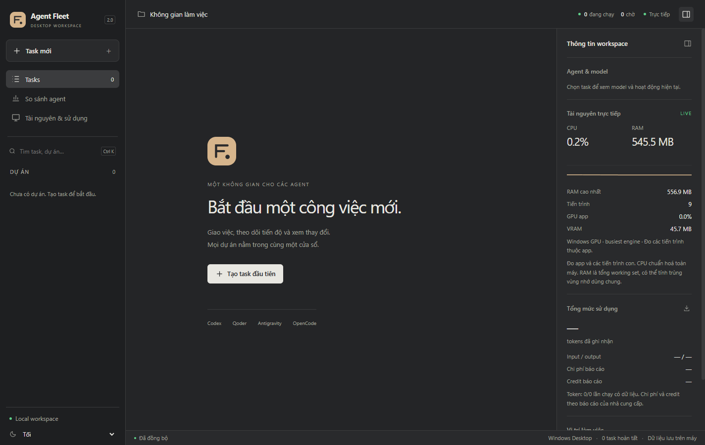

# Agent Fleet Desktop 2.0.0

Ngày: 03/11/2026.

## Dùng ngay

Mở `dist/AgentFleet/AgentFleet.exe`. Nếu chuyển sang máy khác, giải nén toàn bộ
gói `dist/AgentFleet-2.0.0-win-x64.zip`; EXE cần các thư mục `app/` và `runtime/`
đi kèm. Đây là bản portable Windows x64, chưa ký số; chưa phải bộ cài MSI/MSIX.

Dữ liệu mặc định: `%LOCALAPPDATA%\AgentFleetDesktop\`. Phiên bản desktop dùng
server/cổng riêng và không tự nhập database, token hoặc worktree của Fleet cũ.
Node và .NET được đóng gói; Git, WebView2 và các agent CLI cần có trên máy.

## Tính năng

- Một cửa sổ Windows, server chạy ẩn; single instance theo profile, nhớ vị trí
  cửa sổ. Khi có task đang chạy/chờ/tiếp quản, đóng app cần quyết định dừng việc.
- Sidebar dự án/task, tìm kiếm bằng `Ctrl+K`, tạo plan/task trực tiếp trong app,
  giao diện sáng/tối/theo hệ thống.
- Agent có dấu nhận diện, model do CLI báo hoặc được cấu hình rõ ràng, hoạt
  động gần nhất, thời gian chạy, trạng thái lỗi và thời gian không có output.
- Log theo WebSocket; tải bù trạng thái/log khi reconnect hoặc máy thức dậy;
  có đồng bộ dự phòng. Diff đang mở tự cập nhật khi task còn chạy.
- Terminal xterm có resize, font monospace, chỉnh cỡ chữ, tìm kiếm, Copy/Paste,
  `Ctrl+Shift+C/V`, trạng thái kết nối và exit code. `Ctrl+C` vẫn gửi vào shell.
- Mở repo/worktree và vị trí tệp trong Explorer qua cầu nối native; tệp được
  chọn trong Explorer thay vì thực thi qua liên kết định dạng tệp.
- CPU/RAM và biểu đồ lịch sử của app/các tiến trình con; lưu mẫu tổng hợp theo
  run. GPU lấy từ bộ đếm Windows khi khả dụng, dự phòng NVIDIA nếu cần.
- Tổng input/output token, USD và credit do agent báo theo plan; có mức phủ
  dữ liệu, bảng so sánh agent và xuất báo cáo JSON.

## Đọc số liệu đúng

Model chưa được agent báo và chưa được cấu hình rõ ràng sẽ là **chưa rõ**.
Qoder có thể báo tên model nội bộ; ứng dụng không tự thay bằng tên thương mại.
Muốn chọn cố định model khi agent hỗ trợ, đặt cờ model trong
`agents.<id>.extraArgs` của `fleet.config.json` thuộc profile desktop.

Token/USD/credit chỉ cộng dữ liệu được báo. Credit thuê bao của Codex/AGY hoặc
nhà cung cấp khác không được suy ra từ USD/token. `—` là chưa có dữ liệu;
`0` là nguồn dữ liệu báo bằng không. Tổng có thể chỉ bao phủ một phần lịch sử.

CPU chuẩn hoá theo toàn bộ bộ xử lý logic. RAM là tổng working set, có thể
bao gồm trang nhớ dùng chung và khác số private memory trong Task Manager.
Mẫu theo run cách nhau khoảng 5 giây; tiến trình rất ngắn giữa hai mẫu có thể
bị bỏ lỡ. GPU có nhãn phạm vi: app hoặc toàn máy; model chạy trên dịch vụ cloud
không đồng nghĩa với sử dụng GPU trên máy này. Bản web chỉ đo được server Node.

## Review và kiểm tra

Đã dùng Qoder CLI **Efficient** review phần realtime và Codex CLI
**gpt-6.1-sol** review vỏ Windows. Các lỗi được ghi nhận gồm tải bù sau
reconnect, timer bị bỏ sót, bộ nhớ log không giới hạn, nhận diện trùng profile,
quyền sở hữu server/cây tiến trình và độ tin cậy của vòng đời đóng ứng dụng.

- `npm test`: **347/347 PASS**, 19 tệp test; các test realtime mới chạy riêng
  sau tinh chỉnh cũng đạt.
- `npm run test:e2e`: **10/10 PASS**, có reconnect/tải bù, terminal thật, theme,
  tạo task, báo cáo và cầu nối mở vị trí tệp.
- `npm run typecheck`, build web và publish .NET: **PASS**.
- Native policy: **15/15 PASS**, gồm đường dẫn an toàn, profile trùng, sở hữu
  listener và Windows Job Object.
- Hai lần chạy EXE thật: **exit 0**, theme tối giữ nguyên qua hai cổng khác nhau,
  API nhận tài nguyên native/GPU; server dọn sạch sau khi đóng app.
- Thử cưỡng bức dừng host trong profile tạm: server thuộc app được dọn trong 5 giây.
- Kiểm tra UI thật bằng Computer Use: mở thành công, kết nối realtime, đổi tối.
- PE xác nhận **Windows x64, GUI subsystem**; 47 hash nguồn/bản build khớp manifest.

Gói ZIP **87,8 MiB**; toàn thư mục giải nén khoảng **177,9 MiB**, gồm runtime.
Mẫu idle trên máy thử, chưa chạy agent: CPU **0,16%** toàn máy, private memory
**325,0 MiB**, tổng working set **550,4 MiB**, 9 tiến trình. Đây là một mẫu đo,
không phải giới hạn cố định; UI, terminal và agent thật làm thay đổi mức dùng.
Không còn tiến trình `tsx`/`esbuild` chạy kèm server trong bản đóng gói.

[Giao diện task sáng](../images/workspace-light.png) ·
[Terminal tối](../images/terminal-dark.png)

## Có thể nâng cấp tiếp

- Thông báo Windows và tuỳ chọn chạy ở tray khi đóng cửa sổ.
- Chọn model/ngân sách theo task, hàng đợi ưu tiên và cảnh báo tiêu thụ.
- Dò trạng thái đăng nhập/quota theo tài khoản thay vì chỉ dò executable.
- Bộ cài có ký số, tự cập nhật có xác minh chữ ký, kênh stable/beta.
- Thống kê nhiều profile, xuất CSV/OTLP và so sánh hiệu suất theo model.

Xem [kế hoạch](../desktop-upgrade-plan.md) và [hướng dẫn build](../../desktop/README.md).
