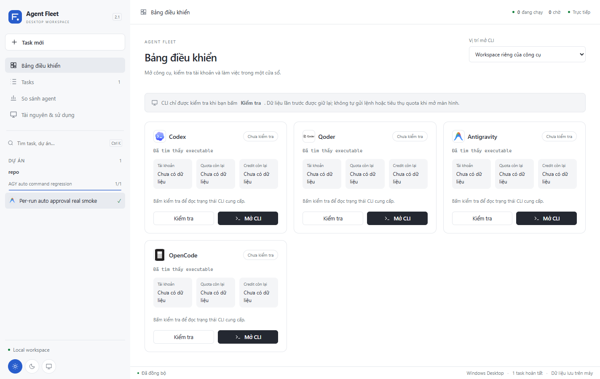
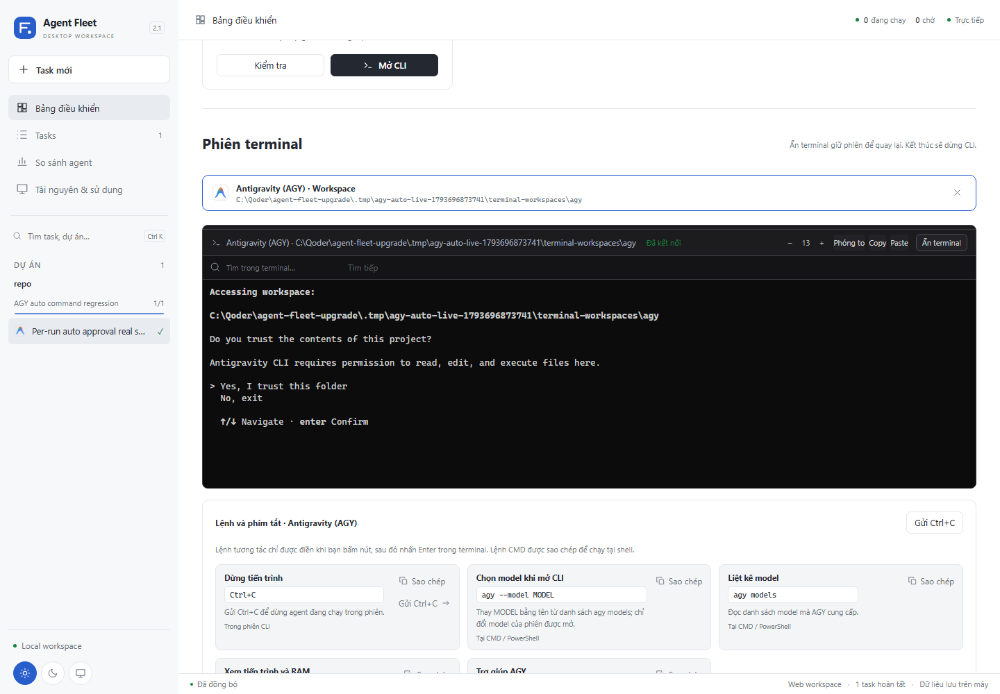

# Agent Fleet Desktop 2.1.0

Đã có [bản vá 2.1.1](2.1.1.md): sửa mở CLI và đọc quota/credit bằng các lệnh
tương tác. Giới hạn kiểm tra trạng thái của 2.1 bên dưới là lịch sử.

Trạng thái: đã tích hợp, kiểm thử và đóng gói portable Windows x64 ngày 03/11/2026.

Đóng bản cũ rồi mở [AgentFleet.exe](../../dist/AgentFleet-2.1.0/AgentFleet.exe), hoặc
giải nén toàn bộ [gói ZIP](../../dist/AgentFleet-2.1.0-win-x64.zip). Giữ `app/` và
`runtime/` cạnh EXE. Gói có Node và .NET; WebView2 dùng runtime Windows.

## Phân công

- DeepSeek-Flash qua Qoder: lập kế hoạch và phân quyền tệp.
- Qwen3.8-Flash qua Qoder: giao diện, logo, kéo giãn cột/terminal, dashboard UI.
- OpenCode: dashboard backend, terminal CLI và thống kê theo công cụ/model.
- Agent chính: quyền AGY theo run, migration, tích hợp, kiểm thử và đóng gói.

Không dùng Qwen Max. Xem [kế hoạch chi tiết](../upgrade-2.1-plan.md).

## Thay đổi

- Giao diện trắng trung tính; ba nút icon sáng/tối/hệ thống; logo công cụ từ
  `asset-logo/`; logo ở đầu hàng, trạng thái thành công/thất bại ở cuối.
- Kéo giãn sidebar, inspector và chiều cao terminal; lưu kích thước trong profile
  native để không mất khi app đổi cổng sau lần khởi động khác.
- Terminal nền đen, bảng màu Windows CMD cố định kể cả khi app dùng giao diện
  sáng; có phóng lớn/khôi phục để theo dõi output dài.
- Dashboard mở CLI trong cửa sổ app, gợi ý lệnh theo công cụ, kiểm tra trạng thái
  và số dư theo thao tác nhấn nút. Không gọi model để kiểm tra quota.
- Tách token/USD/credit theo công cụ và model, giữ mọi model được báo. Phần usage
  không thể phân bổ chính xác cho model được ghi rõ chưa phân bổ.
- Log và tiến độ tự cập nhật qua WebSocket, phục hồi dữ liệu sau mất kết nối;
  mở vị trí tệp qua Explorer; xuất báo cáo sử dụng JSON.
- Đo CPU/RAM/GPU của cây tiến trình desktop; ghi rõ phạm vi đo và hiện chưa có
  dữ liệu khi driver GPU không cung cấp. Đóng app có cảnh báo nếu còn task/CLI.

## Quyền lệnh AGY

Quyền được lưu theo từng run, áp dụng bằng `--settings` của phiên AGY; không ghi
vào cấu hình AGY toàn máy. Có ba lựa chọn:

- `ask`: giữ cơ chế hỏi quyền; headless có thể báo lỗi nếu cần duyệt lệnh.
- `check-only`: duyệt đúng lệnh check và danh sách lệnh được chỉ định.
- `auto`: tự duyệt các yêu cầu lệnh terminal trong lần chạy AGY này.

`auto` là quyền rộng cho lệnh terminal của phiên, không phải sandbox giới hạn
mọi thao tác trong một thư mục. Các quyền khác và các deny-rule đã có được giữ.
Quyền được ghi vào log `command_permissions`; lỗi thực sự vẫn được báo.
Task AGY mới trong UI có thể dùng auto; API cũ không truyền chính sách vẫn là ask.
Retry cùng agent giữ chính sách trước, hoặc dùng lựa chọn mới; đổi agent reset ask.

Ví dụ CLI:

```powershell
npm run fleet -- retry TASK_ID --command-policy auto --note "Cho phép terminal trong lần chạy này"
npm run fleet -- retry TASK_ID --command-policy check-only --allow-command "node check.cjs" --note "Chỉ duyệt check"
```

## Số liệu không được suy diễn

Quota/credit còn lại cần CLI cung cấp. Nếu CLI không có API/lệnh số dư, hiển thị
chưa có dữ liệu cùng lý do và thời gian kiểm tra; không đổi token ra credit.
Credit danh nghĩa từ sự kiện `billable:false` được tách khỏi credit tính phí.
Một tổng usage của run không được nhân lại cho từng model trong run đó.
Thống kê được tổng hợp từ các lần chạy task có output có cấu trúc. Các phiên CLI
tương tác mở từ dashboard hiện không tự chuyển nội dung terminal thành số liệu
token/credit; dùng lệnh trạng thái của CLI khi cần. Model do CLI báo được phân
biệt với model cấu hình, không gán ngược cấu hình mới vào lịch sử cũ.

## Nghiệm thu

- TypeScript: PASS; `npm test`: **402/402**, 24 tệp.
- Playwright: **22/22**, gồm theme, logo, resize/persist, terminal CMD, dashboard
  thủ công, nhiều model, AGY policy, log trực tiếp và reconnect. Sau chỉnh nhãn
  Ctrl+C, chạy lại riêng dashboard: **6/6**.
- Native Windows: **17/17**, gồm bảo vệ đường dẫn, vòng đời tiến trình,
  lưu theme/layout và giới hạn kích thước.
- AGY thật: task `t-asg140`, `commandPolicy:auto`, **done**, check PASS; AGY tự
  chạy `node check.cjs agy`; hoàn thành trong **37.9 giây**, không sửa quyền AGY chung.
- EXE thật: mở hai lần với cùng profile thử và cổng khác nhau; lần đầu light,
  lần sau dark; giữ nguyên sidebar **310**, inspector **380**, terminal **520** px.
- Dashboard trên server đóng gói: mở AGY thật, nhận nội dung terminal, nền đen
  và chữ rõ; đóng/xoá phiên thành công; không gửi prompt, không tự gọi check CLI.
  Thông báo trust workspace ban đầu vẫn do CLI hiển thị cho người dùng.
- Gói portable khoảng **88 MiB ZIP / 178 MiB giải nén**, 90 package Node production;
  không giữ tiến trình tsx/esbuild khi chạy app. Manifest chứa SHA-256 nguồn/build.
- Một mẫu idle của EXE: CPU **0.16%** trên toàn máy, tổng working set **557 MiB**,
  9 tiến trình; working set có thể tính cả trang chia sẻ. Đây là mẫu đo của máy
  phát triển, không phải mức RAM cố định hay cam kết hiệu năng.

Bằng chứng cục bộ: `.tmp/cli-team/{qoder-result,opencode-result}.md`,
`agy-live-result.json`, `native-console-result.json` và profile
`.tmp/agy-auto-live-1793696873741/`. Không đưa token/cấu hình tài khoản vào gói.




