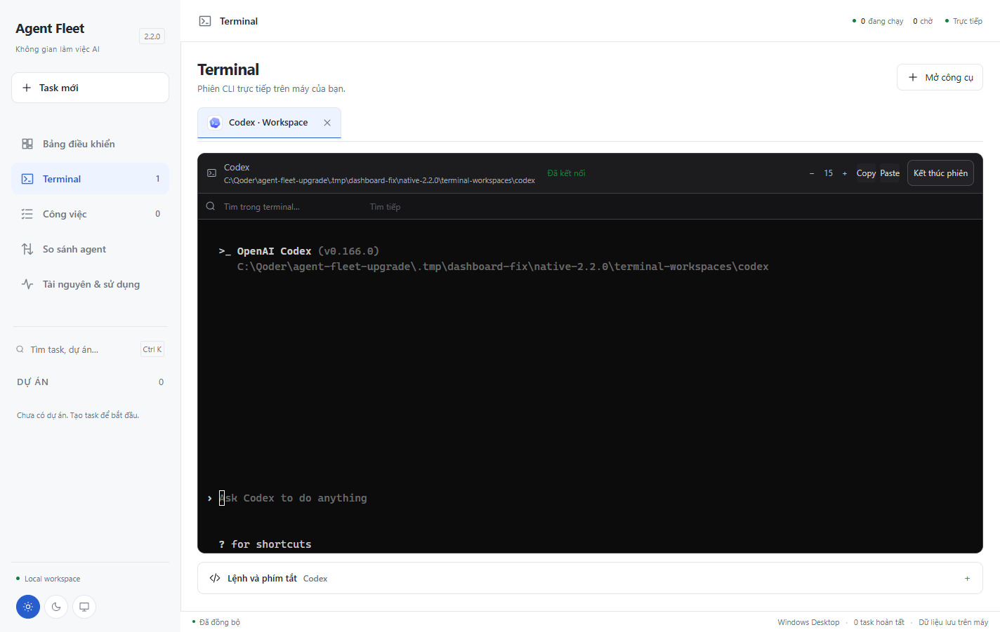
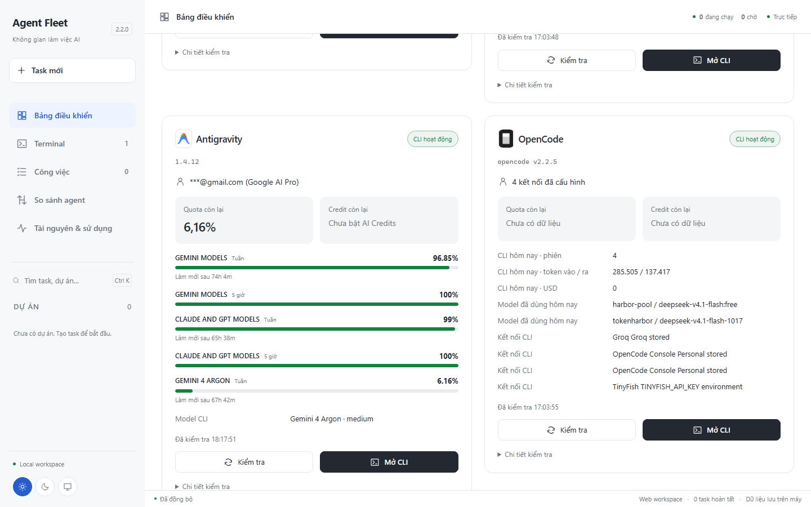

# Agent Fleet Desktop 2.2.0

Tách Terminal thành màn hình riêng, sửa cuộn chuột theo vùng, đọc đầy đủ quota
AGY bằng `/usage` và tăng độ dễ đọc của giao diện.

Đóng bản cũ rồi mở [EXE 2.2](../../dist/AgentFleet-2.2.0/AgentFleet.exe), hoặc
giải nén toàn bộ [ZIP 2.2](../../dist/AgentFleet-2.2.0-win-x64.zip).

## Terminal riêng

- Nút **Mở CLI** chuyển thẳng sang mục **Terminal**. Mỗi phiên có tab, vị trí
  làm việc và nút kết thúc riêng; muốn dừng CLI phải xác nhận.
- Các phiên đã mở giữ nguyên kết nối, tiến trình và lịch sử khi đổi tab hoặc
  chuyển sang Dashboard/Công việc. Thông tin lệnh nằm trong phần gấp gọn.
- Terminal dùng Windows ConPTY và xterm, truyền trực tiếp input/output, màu ANSI,
  phím điều khiển, copy/paste và thay đổi kích thước tới CLI thật.
- Bánh xe trong vùng terminal cuộn scrollback. Khi CLI mở pager, bánh xe gửi
  phím cuộn thật vào PTY; ứng dụng có mouse tracking vẫn nhận protocol chuột.
- Chặn cuộn lan ra trang ở biên terminal. Bánh xe bên ngoài terminal vẫn cuộn
  giao diện; kiểm tra thật với pager `/usage` của AGY đủ từ đầu tới cuối 38 dòng.

## Quota AGY

Kiểm tra theo thứ tự `/help` → `/usage` → `/credits`. Bước trust chỉ áp dụng
thư mục trống riêng do Fleet tạo để kiểm tra; không tự trust repository người dùng.
Đọc cả cuối pager để không bỏ sót nhóm model ở phần dưới.

- Gemini Models: tuần và 5 giờ.
- Claude and GPT Models: tuần và 5 giờ.
- Gemini 4 Argon: hạn mức tuần riêng.

Mỗi nhóm giữ phần trăm còn lại và thời gian làm mới do CLI báo. Không cộng các
phần trăm khác nhóm. Số quota chính theo model đang chọn nếu CLI báo được model.
AI Credits là dữ liệu riêng; trạng thái chưa bật credit không làm mất quota model.

## Giao diện

Bỏ biểu tượng F ở góc sidebar; giữ logo nhà cung cấp ở thẻ công cụ và tab CLI.
Tăng chữ chính, khoảng cách, kích thước icon và nút bấm. Dashboard dùng thẻ hai
cột với tài khoản, quota/credit và chi tiết kiểm tra gọn hơn. Hạn mức thấp có
thanh màu riêng. Navigation thêm Terminal, thống nhất icon và trạng thái chọn.
Terminal mặc định chữ 15px, có nút tăng/giảm; sáng/tối/hệ thống vẫn được giữ.

## Kiểm thử

- **415 test / 27 tệp PASS**; TypeScript PASS.
- **27 E2E PASS**, gồm history, pager normal/alternate, mouse protocol, chặn
  cuộn lan, giữ kết nối qua tab/navigation và đóng tab khi CLI đã tự thoát.
- **17 native regression PASS**.
- AGY thật: cuộn trong đi từ đầu tới cuối pager; cuộn ngoài đổi vị trí trang
  và không gửi phím cuộn vào CLI; Dashboard trả đủ 5 bucket quota.
- Bằng chứng: `.tmp/dashboard-fix/agy-wheel-result.json`, ảnh trong cùng thư mục.
- Bộ thử EXE/WebView2 riêng từng CLI ghi tại
  `.tmp/dashboard-fix/native-2.2.0/native-cli-results.json`.
  Cả Codex, Qoder, AGY và OpenCode đã PASS mở terminal và kiểm tra trạng thái;
  AGY trả đủ 5 bucket quota; EXE thoát 0.

