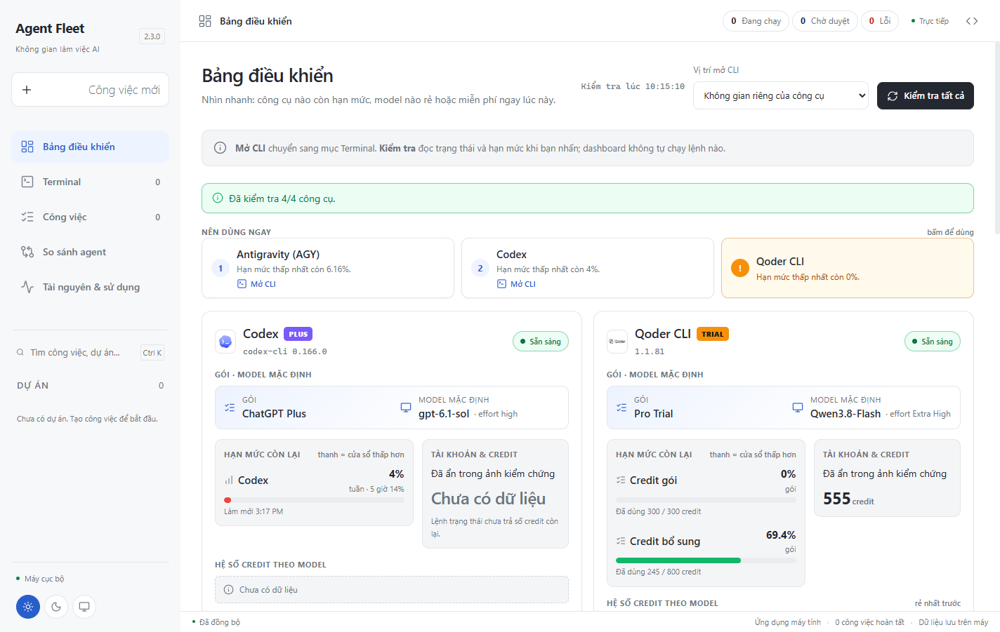
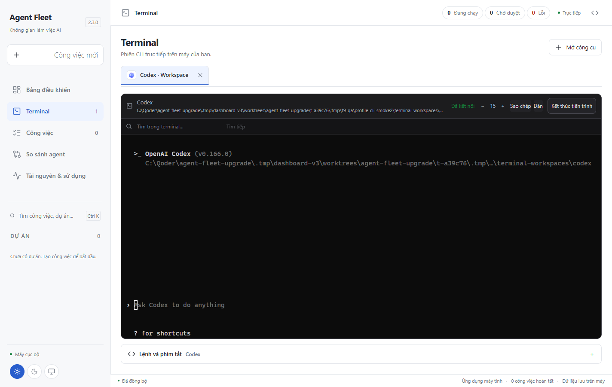
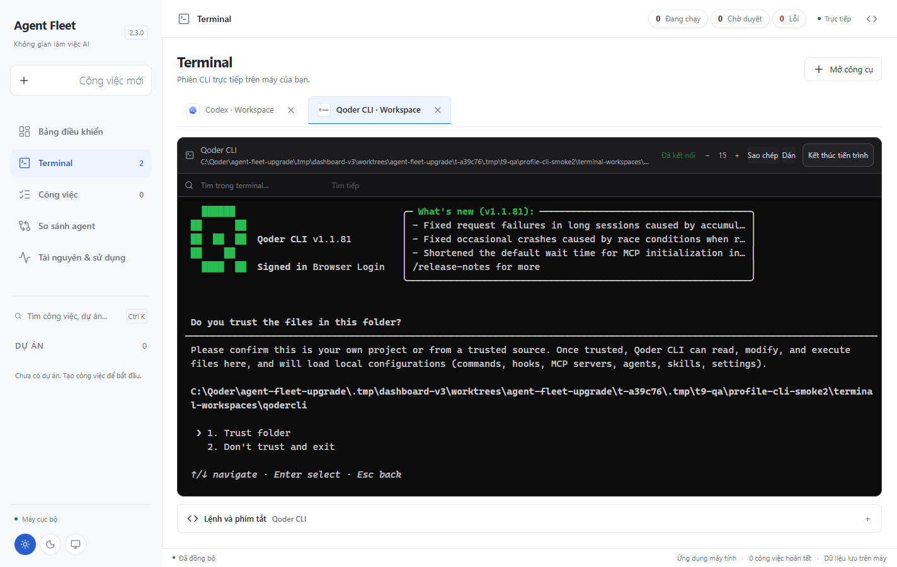
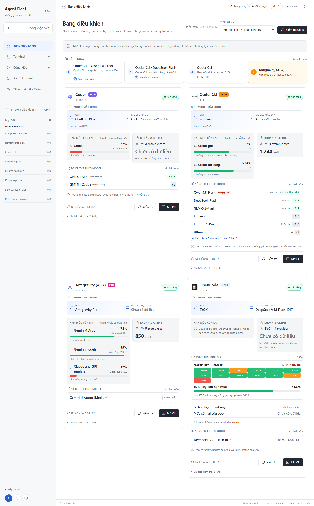
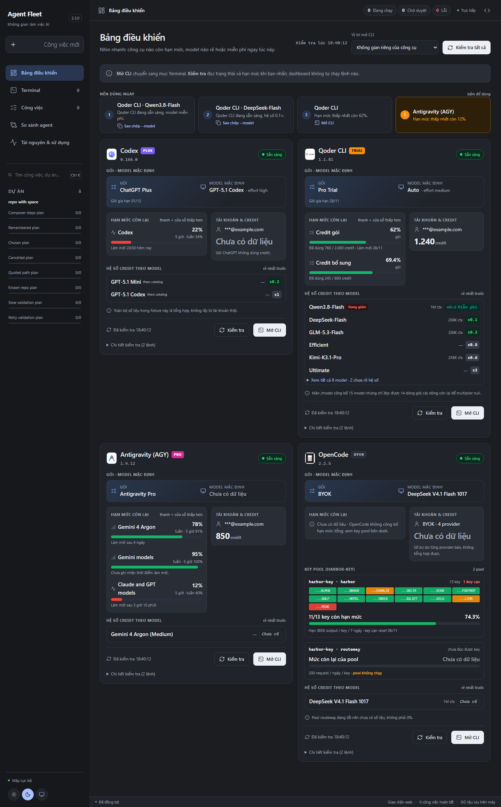
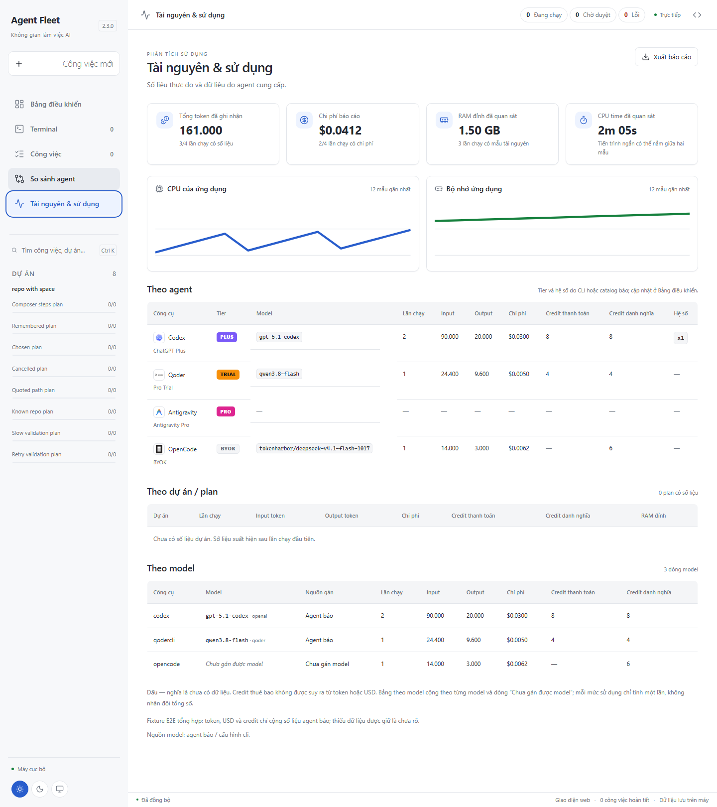

# Agent Fleet Desktop 2.3.0

Dashboard v3: mỗi CLI một thẻ có dữ liệu có cấu trúc (gói, cửa sổ hạn mức, credit,
key pool, hệ số model), thêm dải **Nên dùng ngay**, làm lại trang **Tài nguyên &
sử dụng** và nền tảng giao diện dùng chung (design tokens, icon lucide).

Đóng bản cũ rồi mở [EXE 2.3](../../dist/AgentFleet-2.3.0/AgentFleet.exe), hoặc
giải nén toàn bộ [ZIP 2.3](../../dist/AgentFleet-2.3.0-win-x64.zip).

## Bảng điều khiển

- Mỗi công cụ một thẻ, thông tin quyết định đặt trước: gói và tier, model mặc
  định, thanh hạn mức theo **cửa sổ thấp hơn** (cửa sổ còn lại ghi nhỏ bên cạnh),
  credit, key pool của OpenCode và danh sách model sắp theo hệ số tăng dần.
- Trạng thái đủ cho mọi khối: đang kiểm tra (skeleton), chưa kiểm tra, rỗng,
  lỗi kèm nút thử lại, có dữ liệu. `null` luôn đọc là "Chưa có dữ liệu", không
  bao giờ thành 0%.
- **Kiểm tra tất cả** chạy tuần tự từng công cụ, có thanh tiến độ, báo kết quả
  bằng toast xanh; lỗi thì dừng phần đó, không chặn công cụ khác và giữ toast đỏ
  có nút thử lại.
- Kết quả kiểm tra được lưu vào `<data>/dashboard-checks.json` (định dạng
  `version: 1`, theo từng agent) nên mở lại dashboard không phải chạy CLI lần nữa.

## Nên dùng ngay

- Tối đa 3 gợi ý cộng 1 cảnh báo, xếp bằng `rankPicks`: model miễn phí hoặc hệ số
  ≤ 0.1 của tool đang sẵn sàng trước, sau đó tới tool còn nhiều hạn mức nhất.
- Bấm gợi ý **model** thì sao chép đúng chuỗi `--model <id>` vào clipboard và báo
  đã sao chép; nếu trình duyệt chặn clipboard thì hiện lỗi kèm lệnh để tự dán.
  Gợi ý model **không** mở terminal.
- Bấm gợi ý **tool** mở CLI đúng agent như nút "Mở CLI".

## Tài nguyên & sử dụng

- KPI dùng chung style với dashboard. Khi chưa có lần chạy, biểu đồ hiện hướng
  dẫn thay vì vẽ đường phẳng và bảng giữ "Chưa có dữ liệu".
- Bảng theo agent có badge tier, credit và hệ số; bảng theo model tách rõ dòng
  "Chưa gán được model".
- Bảng và biểu đồ xếp lại một cột ở màn hẹp, không cuộn ngang.

## Giao diện

- Design tokens (màu, khoảng cách, bo góc, chữ) và icon lucide thay bộ icon cũ.
- Logo Qoder và OpenCode nằm trong chip có nền riêng, đọc được ở cả hai theme.
- Sidebar thu hẹp đúng theo breakpoint (biến rộng do người dùng kéo không còn đè
  media query).
- Các nhãn chung còn tiếng Anh đã chuyển sang tiếng Việt: **KHÔNG GIAN LÀM VIỆC AI**,
  **PHÂN TÍCH SỬ DỤNG**, **Giao diện web**, **Ứng dụng máy tính**.

## Kích thước gói

Đo trên bản build Windows x64 self-contained tại máy phát triển. Mục tiêu
`app/ < 15 MB` đã đạt; **mục tiêu tổng gói < 115 MB chưa đạt**.

| Hạng mục | 2.2.0 (trước T0.1) | 2.3.0 | Ghi chú |
|---|---:|---:|---|
| `app/` | 40.52 MiB | **3.48 MiB** | Server bundle + web build + PTY win32-x64 |
| `runtime/` (Node) | — | 89.21 MiB | Portable Node, không đổi stack |
| `AgentFleet.exe` (.NET) | — | 49.58 MiB | Self-contained .NET 10 + WebView2 |
| Tổng thư mục | 179.92 MiB (188.654.674 B) | **142.96 MiB (149.906.566 B)** | Giảm 36.96 MiB |
| ZIP | 89.96 MiB (94.327.932 B) | **79.06 MiB (82.897.560 B)** | Giảm 10.90 MiB |

T0.1 đo được `app` 3.37 MiB, tổng 142.85 MiB và ZIP 79.02 MiB; 2.3.0 tăng khoảng
0.11 MiB vì bundle Dashboard v3 và bộ icon mới. Lý do chưa đạt 115 MB: riêng
`runtime/node.exe` và .NET self-contained đã vượt mục tiêu. Muốn xuống dưới 115 MB
phải đổi stack/portability (ví dụ bỏ Node hoặc chỉ phát hành framework-dependent),
nằm ngoài phạm vi 2.3.0 và không được thực hiện.

## Sửa lỗi tích hợp cuối

- **Credit Qoder hiện sai mẫu số.** Ảnh kiểm tra thật cho thấy `555 / 300 credit`:
  parser Qoder cộng đúng số dư của gói và credit bổ sung, nhưng `CreditPanel` ghép
  tổng đó với `limit` của **cửa sổ đầu tiên** — hai đại lượng khác nhau. Nay khi
  có nhiều nguồn credit, thẻ chỉ hiện số dư báo cáo (`555 credit`) và giữ nguyên
  từng thanh hạn mức riêng (`Đã dùng 300 / 300`, `245 / 800`); mẫu số chỉ hiện khi
  đúng một cửa sổ credit có `limit` xác định. Không suy ra tổng từ `limit` thiếu
  hoặc `null`, và không đổi parser Qoder. Test hồi quy dùng đúng bộ số tổng hợp
  `remaining 555`, `used 300 / limit 300`, `used 245 / limit 800`.
- **Smoke terminal báo "rendered" khi ảnh còn đen.** Helper cũ chọn
  `.terminal-session:not([hidden])` nên trong lúc React chuyển tab vẫn thấy CLI
  trước đó, và kiểm tra chữ **trước** khi chờ thêm 1.5 s rồi chụp. Nay helper yêu
  cầu đúng tab/caption của agent đang mở, trạng thái "Đã kết nối", khung đọc được
  (≥ 2 dòng, ≥ 8 chữ cái) và **ổn định qua hai lần lấy mẫu** (giới hạn 40 s), rồi
  kiểm tra lại ngay trước khi chụp. Qoder cần ~2 s mới vẽ khung đầu tiên nên lỗi
  trước đây là lỗi thời điểm của smoke, không phải lỗi render của ứng dụng.

## Kiểm thử

| Check | Lệnh | Kết quả |
|---|---|---|
| TypeScript | `npx tsc --noEmit` | PASS |
| Unit / integration | `npx vitest run` | **690 test / 42 tệp PASS** |
| E2E Playwright | `FLEET_E2E_PORT=4642 npx playwright test` | **106 test PASS** (1.9 phút, teardown sạch) |
| Native policy | `dotnet run --project desktop/tests/PathPolicy.Tests.csproj` | **25 case PASS** |
| Đóng gói | `npm run desktop:build -- -OutputName AgentFleet-2.3.0` | PASS, 73 package, `app` 3.48 MiB, tổng 142.962 MiB |
| Smoke "Kiểm tra tất cả" | EXE 2.3.0, profile cách ly | **exit 0**, 44.2 s, 4/4 CLI `ready` |
| Smoke terminal từng CLI | EXE 2.3.0, profile cách ly | **exit 0**, 61 s, 4/4 khung ổn định + check `ready` |

- Ảnh ma trận được tạo lại sau khi nâng version và sau khi sửa `CreditPanel` nên
  hiển thị **2.3.0** và số dư Qoder `1.240 credit` không kèm mẫu số sai.
- **Kiểm tra tất cả** thật: Codex `ChatGPT Plus` (PLUS, 2 cửa sổ), Qoder
  `Pro Trial` (TRIAL, 2 cửa sổ, 15 model, 555 credit), AGY `Google AI Pro` (PRO,
  5 cửa sổ, 13 model), OpenCode `BYOK` (BYOK, 62 model, 2 key pool).
- Khung terminal thật đọc được: Codex 4 dòng, Qoder 15 dòng, AGY 8 dòng, OpenCode
  12 dòng (`native-cli-results.json` ghi `frameLines`/`settledLines`).
- Không gửi yêu cầu lập trình nào tới Codex/Qoder/AGY/OpenCode; chỉ mở terminal,
  đọc trạng thái/hạn mức. Không chạy `harbor-key check/reset` hay lệnh ghi config.

## Ảnh

**Ảnh tổng hợp** (dữ liệu fixture, không phải tài khoản thật) nằm trong
[`docs/images/2.3/`](../images/2.3): ma trận 375 / 768 / 1440 px × sáng/tối cho
Dashboard và trang Tài nguyên. Mỗi ảnh chỉ được chụp sau khi kiểm tra computed
layout (`scrollWidth ≤ innerWidth`, không phần tử tràn).

**Ảnh CLI thật** nằm riêng trong [`docs/images/2.3/live/`](../images/2.3/live),
kèm bản tóm tắt đã lọc `check-all-real-cli.json` và `cli-smoke-results.json`
(không có output probe, token hay tên tài khoản). Ảnh Dashboard đã ẩn nhãn tài
khoản trước khi chụp. Đây là dữ liệu tại máy phát triển ngày 04/11/2026, có thể
thay đổi theo hạn mức thực tế.

## Giới hạn đã biết

- Ảnh tổng hợp dùng `test/e2e/fixtures/dashboard-checks.json` và snapshot ghim
  theo route; không dùng để chứng minh quota thật.
- Ảnh CLI thật chỉ chứng minh thời điểm chạy. Qoder và AGY vẫn hiện prompt trust
  trong terminal mở tự động; smoke không tự chấp nhận trust và không ghi cấu hình CLI.
- Máy khác có thể có version CLI hoặc màn hình `/usage` khác; parser trả `null`
  kèm lý do thay vì đoán số.
- Mục tiêu tổng gói < 115 MB **chưa đạt** (xem bảng kích thước).
