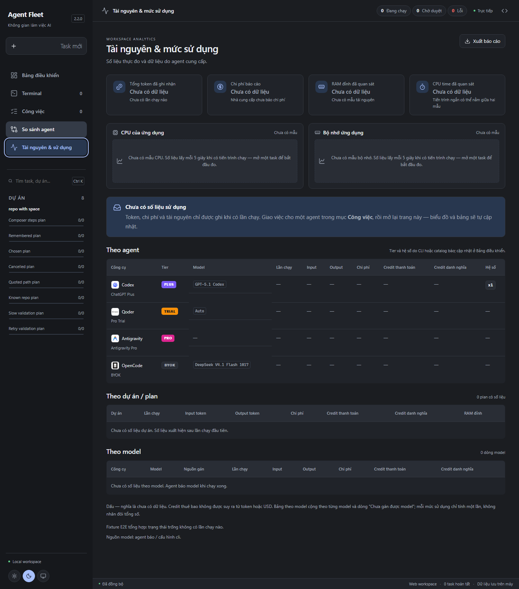
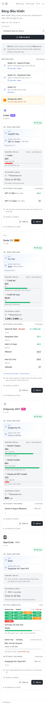
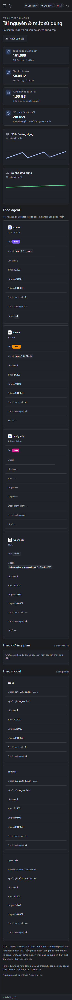

# Agent Fleet Desktop 2.3.0

Dashboard v3: mỗi CLI một thẻ có dữ liệu có cấu trúc (gói, cửa sổ hạn mức, credit,
key pool, hệ số model), thêm dải **Nên dùng ngay**, làm lại trang **Tài nguyên &
sử dụng** và nền tảng giao diện dùng chung (design tokens, icon lucide).

> **Lưu ý về bằng chứng:** toàn bộ ảnh và con số trong ghi chú này là **dữ liệu
> tổng hợp** (`test/e2e/fixtures/dashboard-checks.json` và các snapshot dựng
> trong `test/e2e/dashboard-v3.spec.ts`), không lấy từ tài khoản thật. Cả hai
> ảnh Tài nguyên — trạng thái trống và trạng thái có dữ liệu — đều dùng snapshot
> ghim theo route, nên không phản ánh lịch sử chạy thật của máy. Bước kiểm tra
> cuối trên desktop (EXE/WebView2) và trên 4 CLI thật thuộc **T9** và chưa chạy
> ở đây. Không dùng các ảnh này làm bằng chứng quota thật.

## Bảng điều khiển

- Mỗi công cụ một thẻ, thông tin quyết định đặt trước: gói và tier, model mặc
  định, thanh hạn mức theo **cửa sổ thấp hơn** (cửa sổ còn lại ghi nhỏ bên cạnh),
  credit, key pool của OpenCode và danh sách model sắp theo hệ số tăng dần.
- Trạng thái đủ cho mọi khối: đang kiểm tra (skeleton), chưa kiểm tra, rỗng,
  lỗi kèm nút thử lại, có dữ liệu. `null` luôn đọc là "Chưa có dữ liệu", không
  bao giờ thành 0%.
- **Kiểm tra tất cả** chạy tuần tự từng công cụ, có thanh tiến độ, báo kết quả
  bằng toast xanh; lỗi thì dừng phần đó, không chặn công cụ khác và giữ toast đỏ
  có nút thử lại.
- Kết quả kiểm tra được lưu vào `<data>/dashboard-checks.json` (định dạng
  `version: 1`, theo từng agent) nên mở lại dashboard không phải chạy CLI lần nữa.

## Nên dùng ngay

- Tối đa 3 gợi ý cộng 1 cảnh báo, xếp bằng `rankPicks`: model miễn phí hoặc hệ số
  ≤ 0.1 của tool đang sẵn sàng trước, sau đó tới tool còn nhiều hạn mức nhất.
- Bấm gợi ý **model** thì sao chép đúng chuỗi `--model <id>` vào clipboard và báo
  đã sao chép; nếu trình duyệt chặn clipboard thì hiện lỗi kèm lệnh để tự dán.
  Gợi ý model **không** mở terminal.
- Bấm gợi ý **tool** mở CLI đúng agent như nút "Mở CLI".

## Tài nguyên & sử dụng

- KPI dùng chung style với dashboard. Khi chưa có lần chạy, biểu đồ hiện hướng
  dẫn thay vì vẽ đường phẳng và bảng giữ "Chưa có dữ liệu".
- Bảng theo agent có badge tier, credit và hệ số; bảng theo model tách rõ dòng
  "Chưa gán được model".
- Bảng và biểu đồ xếp lại một cột ở màn hẹp, không cuộn ngang.

## Giao diện

- Design tokens (màu, khoảng cách, bo góc, chữ) và icon lucide thay bộ icon cũ.
- Logo Qoder và OpenCode nằm trong chip có nền riêng, đọc được ở cả hai theme.
- Sidebar thu hẹp đúng theo breakpoint (biến rộng do người dùng kéo không còn đè
  media query).

## Kiểm thử

- Đơn vị: `npx vitest run` — **672 test / 40 tệp PASS**; `npx tsc --noEmit` PASS.
- E2E Playwright: **106 test PASS** (`FLEET_E2E_PORT=4640 npm run test:e2e`), gồm bộ
  mới `test/e2e/dashboard-v3.spec.ts` (8 test, trong đó 1 test hồi quy độc lập thứ
  tự) và ca clipboard bị chặn của dải gợi ý.
- `test/e2e/dashboard-v3.spec.ts` kiểm tra bằng dữ liệu thật của server:
  `global-setup.ts` chép fixture vào `<FLEET_DATA_DIR>/dashboard-checks.json`
  **trước khi** server khởi động, rồi test gọi `GET /api/dashboard` đã xác thực và
  so khớp nguyên vẹn `plan`, `currentModel`, `quotaWindows`, `models`, `keyPools`,
  `highlights`. Không mock toàn bộ API và không chạy CLI nào (agent bị tắt trong
  cấu hình E2E).
- Trang Tài nguyên dùng snapshot tổng hợp ghim theo route: bản **trống** cố định
  (`runCount: 0`, không có dòng usage) và bản **có dữ liệu** cố định. Trạng thái
  trống không đọc `/api/observability` thật, vì lịch sử chạy dùng chung thay đổi
  theo thứ tự test (bộ E2E có test tạo task fake-agent). Test hồi quy
  "trạng thái trống tổng hợp vẫn trống dù server đã có lần chạy fake-agent" tự tạo
  một lần chạy thật, xác nhận `/api/observability` đã có số liệu, rồi chứng minh
  fixture rỗng vẫn hiện đúng trạng thái trống. Kịch bản thứ tự
  (`ui.spec.ts` tạo lịch sử chạy → `dashboard-v3.spec.ts` kiểm tra trạng thái
  trống) đã được chạy lại và pass.
- Ảnh chụp 375 / 768 / 1440 px ở cả hai theme cho Dashboard và cho trang Tài
  nguyên (cả trạng thái trống lẫn có dữ liệu đều dùng snapshot tổng hợp). Mỗi ảnh
  chỉ được chụp sau khi kiểm tra computed layout:
  `document.documentElement.scrollWidth ≤ innerWidth`, vùng cuộn không tràn và
  không phần tử nào thò ra ngoài khung. Không ẩn overflow để né lỗi.
- **Chưa kiểm chứng:** smoke trên CLI thật và trên EXE/WebView2 (T9), độ tương
  phản màu của dữ liệu thật, và hành vi clipboard trong WebView2.

## Ảnh

Ma trận đầy đủ nằm trong [`docs/images/2.3/`](../images/2.3) (18 ảnh, tất cả đều
là dữ liệu tổng hợp; ảnh Tài nguyên trống dùng snapshot rỗng ghim sẵn).

